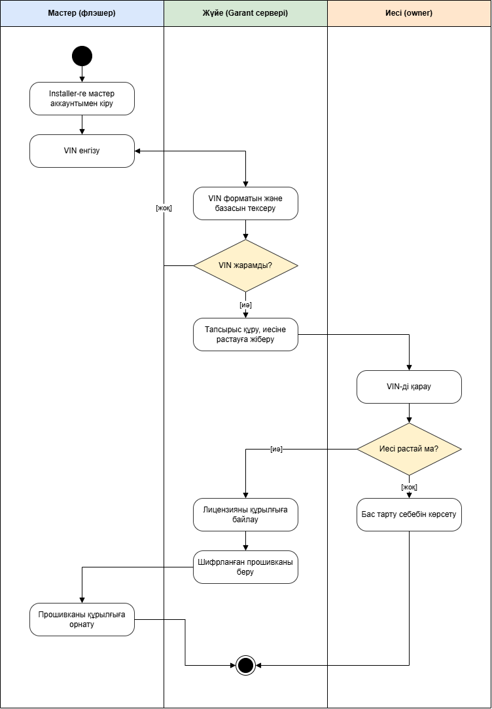

# Garant Motors

Автор: [Аты Тегі], [топ]

## Мәселе
Қытай автомобильдерінің мультимедиа блоктары мен аспаптар панелінде орысша/қазақша бағдарламалық жасақтама жоқ, ал прошивканы қолмен орнату қорғалмаған және оны басқа құрылғыға көшіріп алуға болады. Жүйе прошивканы жергіліктендіріп, VIN бойынша иесінің растауымен қорғалған түрде қашықтан орнатуға мүмкіндік береді. Ол мастерлерге (флэшерлерге) және автокөлік иелеріне керек.

## Акторлар
- Мастер (флэшер)
- Иесі (owner / админ)
- Жүйе (Garant сервері)

## Талаптар
### Функционалдық
1. Жүйе VIN бойынша орнатуды иесі растағаннан кейін ғана ашуы керек.
2. Жүйе лицензияны нақты құрылғыға байлауы керек.

### Функционалдық емес
1. Прошивка серверде шифрленген күйде сақталуы керек.

## Диаграммалар
### 1. Use Case

### 2. Class

### 3. Activity: Прошивканы VIN бойынша орнатуға тапсырыс беру

### 4. Sequence: Прошивканы VIN бойынша орнатуға тапсырыс беру

